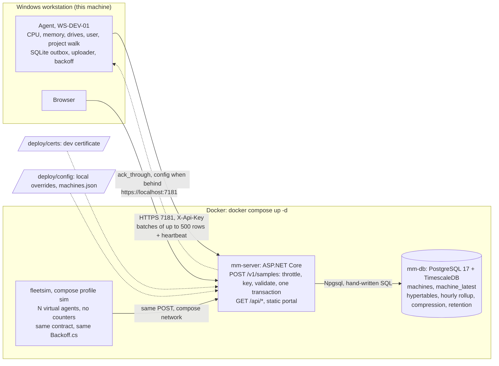

# Machine Monitoring PoC

Proof of concept for the Machine Monitoring Solution design: a .NET agent on
each Windows machine samples CPU, memory and drives into a local SQLite
outbox and pushes batches over HTTPS to one ASP.NET Core server, which
persists them in PostgreSQL + TimescaleDB and serves a small browser portal.

The five things the brief asked to see, and where they live:

| Asked for | Where |
|-----------|-------|
| A Windows agent collecting CPU, memory and disk | `src/Agent/Sampling`, `src/Agent/SamplingLoop.cs` |
| Sending the data to a central API | `src/Agent/Uploader.cs` → `POST /v1/samples` in `src/Server/Ingest` |
| Persisting the received data | `src/Server/Db/schema.sql`, `src/Server/Ingest/PostgresSampleStore.cs` |
| A simple way to retrieve or view the data | `src/Server/Api/QueryApi.cs`, `src/Server/wwwroot/index.html` |
| Resilience when the server is unavailable | `src/Agent/Outbox.cs`, `src/Agent/Backoff.cs`, `scripts/outage-demo.ps1` |

The commit history is one step per commit, in the order listed under
[Progress](#progress), so the evolution can be followed commit by commit.

## Architecture

The design's three boxes, as the PoC runs them. Every arrow that leaves the
workstation is outbound: nothing listens there, and the server holds no
credentials for the fleet.



Against the design's diagram: an API key stands in for the machine
certificate, one static page for the React portal, Compose on one host for
the VM, and the simulated fleet is an addition for load runs. The agent is
the one component that never runs in a container, because it reads Windows
counters. The two mounted folders are git-ignored and explain the two setup
commands below.

## Measured at 200 machines

The design is sized for 200 machines and says "about 3 batches a second".
Measured with the simulated fleet on 2026-10-29, server and database in
their containers, everything on one laptop. Full table and the raw JSON
summaries are described in `tools/FleetSim/results.md`.

```powershell
docker compose run --rm fleetsim steady --agents 200 --minutes 10
```

| Measure | Result |
|---------|--------|
| Batches | 2,001 in ten minutes, 3.33/s against a 3.33/s target |
| Latency per batch | p50 11 ms, p99 48 ms |
| Server | 1 to 3 % of one core, about 100 MB |
| Database | about 1 % of one core, under 100 MB |
| Rows | 2,403 sent, 2,403 acknowledged, every one in the database |

Two of the 2,001 batches failed on the chunk deadlock described under
[Issues found by the load runs](#issues-found-by-the-load-runs), three seconds into a fresh database; both
agents retried and nothing was lost. The deadlock has been fixed since
(step 22); the figures above are from the run that found it.

```powershell
docker compose run --rm fleetsim storm --agents 200 --backlog-hours 6
```

| Measure | Result |
|---------|--------|
| Backlog | 86,400 rows, 432 per machine, at their original timestamps |
| Drain | 149 s from first post to last acknowledgement, zero 429s |
| Latency per 432-row batch | p50 268 ms, p99 578 ms |
| Database | 25 to 65 % of one core over the drain, single peaks at one full core |
| Server | 5 to 7 % of one core |

The drain time equals the width of the agents' jitter window, so the fleet's
spread set the pace and the server never had to shed load. The storm was
started 81 s into the steady run, so it drained on top of live traffic; both
figures are therefore slightly harsher than the matrix intends, and all
three containers shared the machine, so the costs are upper bounds. The
1,000-machine runs have not been done yet.

## Prerequisites

- Windows 10 or 11 (the agent reads Windows performance counters and Win32
  memory APIs; it is Windows-only by design)
- .NET SDK 10.0 (built with 10.0.402)
- Docker Desktop, for the database and the server. The agent is the one
  component that never runs in a container.
- The ASP.NET Core development certificate. The server container serves
  HTTPS with it, exported once by `deploy\export-dev-cert.ps1` into the
  git-ignored `deploy/certs/`. Either trust it with
  `dotnet dev-certs https --trust`, or leave the agent's Development profile
  as is: it sets `TrustAnyServerCertificate`, which skips validation and logs
  a warning. Development only.

NuGet packages: `Npgsql`, `Microsoft.Data.Sqlite`,
`System.Diagnostics.PerformanceCounter`,
`Microsoft.Extensions.Hosting.WindowsServices`. The portal loads Chart.js from
a CDN. No ORM, no front-end build.

## Build and run

```powershell
.\deploy\export-dev-cert.ps1         # once: the server container serves HTTPS with the dev certificate
docker compose up -d                 # TimescaleDB on PostgreSQL 17 (port 5432, mm / mm, db monitoring) + the server on https://localhost:7181
dotnet build MachineMonitoring.slnx
dotnet test MachineMonitoring.slnx   # unit tests for agent, server and simulator logic
.\scripts\run-agent.ps1              # samples this machine and uploads every 10 s
```

Then open <https://localhost:7181>. Within about 30 seconds the fleet table
shows this machine as online with its CPU, memory, drives and active user, and
the chart fills in. The agent runs with the Development profile, which uses
short intervals (2 s CPU tick, 10 s cpu_mem, 30 s drives, 2 min project walk,
10 s upload) so a demo shows data quickly. The server container runs with the
Production profile, so the config it hands out is the design's (60 s, 5 min,
nightly walk at 02:00); the agent switches to those on its first ack.

To step through the server instead, stop the container and run it on the
host: `docker compose stop server`, then `.\scripts\run-server.ps1`
(Development profile, same port).

To see a fleet rather than one machine, or on a computer without Windows
where the agent cannot run, use the simulated fleet:

```powershell
docker compose run --rm fleetsim prepare --agents 20         # register SIM-0001..0020 with the server; no traffic yet
docker compose restart server                                # the server reads the registry at startup
docker compose run --rm fleetsim steady --agents 20 --minutes 5   # 20 machines reporting normally for five minutes
```

Twenty simulated machines appear in the fleet table beside the real one,
online while the run lasts and off when it ends. They read no counters;
everything from their queue onwards is the agent's own behaviour. The
commands, a five-minute smoke test and the load-run matrix are in
`tools/FleetSim/README.md`.

The projects table stays empty until the agent is given a folder to size:
create the git-ignored `deploy/config/appsettings.Local.json` (or
`src/Server/appsettings.Local.json` when the server runs on the host) with
`{ "AgentConfig": { "Version": 2, "ProjectRoot": "C:/path/to/your/repos" } }`.
The server reloads it without a restart; the version bump makes a running
agent pick the change up on its next heartbeat.

Useful endpoints:

| Endpoint | Purpose |
|----------|---------|
| `POST /v1/samples` | Ingest. Needs `X-Api-Key`. Body and reply shapes are in `src/Shared`. |
| `GET /api/machines` | Fleet overview from `machine_latest`, with status. |
| `GET /api/machines/{id}/metrics?from&to` | CPU and memory points; resolution chosen from the range. |
| `GET /api/projects` | Latest project folder sizes per machine, grouped by project. |
| `GET /health` | Liveness. |

The one registered machine is `WS-DEV-01` with key `dev-key-ws-dev-01`, in
the server's `appsettings.json` under `Machines`. To run a second agent, add
another entry and point the second agent's `Agent:ApiKey` at it.

## Outage demo

```powershell
docker compose up -d db
dotnet build MachineMonitoring.slnx
.\scripts\outage-demo.ps1            # -OutageSeconds 60 by default
```

The script needs the server as a host process it can kill, so it stops the
server container first if one is running. It starts the server and the agent in their own windows, lets the
first batches be acknowledged, kills the server for a minute, then restarts
it. In the agent window you see uploads fail, retries backing off with
jitter while the outbox depth climbs, and on recovery one batch draining the
backlog. The script then queries the API: the chart points sampled during the
outage are present with their original timestamps, so the portal shows a
delay, never a hole. Finish by pressing Ctrl+C in the agent window: the final
heartbeat flags a clean stop and the fleet table shows the machine as off,
whereas killing the process leaves it unresponsive after three missed
heartbeats.

## What is implemented

**Agent** (`src/Agent`, a .NET worker that is a console app by default)

- `CpuSampler` reads `Processor Information\% Processor Time\_Total` every
  tick and reports the average when the interval closes, so a value is a mean
  over the window, not a snapshot. `MemorySampler` calls `GlobalMemoryStatusEx`
  for physical memory and commit charge.
  `DriveSampler` keeps fixed, ready drives only. `SamplingLoop` is the one
  timer that drives them.
- `Outbox` writes every sample to `data/outbox.db` (SQLite, WAL,
  `synchronous=FULL`) before anything is sent. `seq` is
  `INTEGER PRIMARY KEY AUTOINCREMENT`, so it is never reused even after
  acknowledged rows are deleted. The install id lives in the same file, so
  sequence and install id reset together if the file is wiped.
- `Uploader` posts the oldest rows (at most 500) with a heartbeat and deletes
  rows only after the reply's `ack_through` covers them. A full batch is
  followed immediately by the next one. A heartbeat-only post goes out when
  the outbox is empty.
- `Backoff`: every failure (connection refused, timeout, 5xx, bad
  certificate) waits an exponentially growing, jittered delay while sampling
  continues; a 429 honours `Retry-After`. The outbox is capped at 7 days and
  logs an error if it ever drops rows.
- `ConfigCache` persists the last server config in the outbox's meta table
  and reports its version in every heartbeat. Intervals change without a
  restart. The heartbeat also carries active user, outbox depth, the
  lifetime restart count, the starts inside the last hour, the last error
  from any loop and a `stopping` flag on clean shutdown.
- Restart-loop flag: the outbox stamps every process start and reports how
  many fall inside the last hour, so an hour of steady running clears it
  without a timer. The server flags three or more (`Status:RestartLoopStarts`),
  matching the service's restart-twice-then-stop recovery, and the portal
  shows "restart loop" beside the status. The lifetime count alone cannot
  tell a crash loop from a year of reboots.
- Every loop catches per iteration. A bad CPU tick, a failed walk, a reply
  that is not JSON or a SQLite error under the outbox is logged, shown as
  `last_error` in the portal and retried on the next tick or backoff. Nothing
  short of shutdown stops the host, which is what "keep sampling, drain the
  backlog later" needs.
- `UserSampler` asks `WTSEnumerateSessions` for the user of the active
  console session and the registry's `LastLoggedOnUser` for the last user to
  sign in. The process identity is never used: under the Service Control
  Manager it is LocalSystem, which is not who is at the keyboard.
- `ProjectWalker` sizes each first-level folder under the configured project
  root, once when the root is set and then nightly at `ProjectWalkHour`
  (02:00 local). `IdleThread` runs the walk on its own thread at lowest CPU
  priority and in Windows background mode, which also lowers I/O priority,
  so a build on the workstation always wins.
- `ServiceInstaller`: `--install` and `--uninstall` register the same binary
  as a Windows Service with auto start and restart-twice-then-stop recovery.

**Server** (`src/Server`, one ASP.NET Core app)

- `POST /v1/samples`: identity from the `X-Api-Key` header, never the body.
  `IngestThrottle` and `ApiKeyAuth` run as middleware on that path, before
  the body is read: a saturated server answers 429 with `Retry-After` and an
  unknown key gets 401 without parsing a byte. `BatchValidator` checks shape;
  the 500-row cap is one constant in `Shared` that the agent clamps its own
  setting to. The reply carries config only when the agent's version is
  behind.
- `PostgresSampleStore`: upserts the machine row on its own, then one
  transaction per batch inserts history with `ON CONFLICT DO NOTHING` (one
  `NpgsqlBatch`, one round trip) and upserts `machine_latest`. A resend
  stores nothing new and acks the same number. The machine row sits outside
  the transaction because holding it deadlocked against TimescaleDB creating
  a new weekly chunk (see Issues found by the load runs). A payload that does not parse is logged and acked rather than
  rejected, so a poison row cannot wedge an agent.
- `schema.sql` is the design's tables made literal, embedded in the server
  and applied idempotently on every start: `machines`, `machine_latest`,
  hypertables `cpu_mem_samples`, `drive_samples`, `project_sizes`; an hourly
  continuous aggregate with avg/min/max; compression after 7 days; 13-month
  retention. All as policies, not jobs.
- `QueryApi`: the fleet overview is one query over `machine_latest` and never
  scans history. Status is computed at read time with hysteresis
  (unresponsive after three missed heartbeats, online on the next one, off
  after a stopping heartbeat). Metrics pick raw (up to 1 h), 5-minute (up to
  7 d) or hourly resolution from the range, as the design says; the hourly
  path reads the continuous aggregate.
- `Dockerfile` and the Compose `server` service: a two-stage build to the
  runtime image, started with the database by `docker compose up -d`. The
  git-ignored overrides and the machine registry (`machines.json`) are
  mounted from `deploy/config/`, never baked into the image; `ConfigDir`
  tells the server where to look. The server can still run on the host with
  `dotnet run` when stepping through it matters more than one command.
- `wwwroot/index.html`: fleet table, one CPU/memory chart on a single
  0 to 100 % axis with a real-time x-axis, and a projects table. Where a
  machine has no samples (the agent was not running) the line is left empty
  rather than bridged; a server outage leaves no hole because the backlog
  arrives with its original times. Refreshes every 10 s. Chart.js, no
  framework, no build step.

**Shared** (`src/Shared`): the wire contract as records, snake_case JSON, so
agent and server can never disagree on the shape.

**FleetSim** (`tools/FleetSim`): a simulated fleet against the real server,
so the design's scale numbers (3 batches/s at 200 machines, the six-hour
outage, hold at 1,000) are measured rather than estimated. The virtual
agents read no counters; everything from the queue onwards is the agent's
behaviour, with its `Backoff.cs` linked in. `steady` is the normal minute at
fleet scale, `storm` is the recovery after an outage, and `--lost-ack-pct`
forces resends to prove the idempotency key. Its README has the run matrix
and `results.md` the measured numbers.

## Assumptions and simplifications

| Design | PoC | Why |
|--------|-----|-----|
| Mutual TLS with AD CS machine certificates | Per-machine API key in `X-Api-Key` over the dev HTTPS certificate | mTLS needs a domain CA. Identity is still taken from the credential, never the body. |
| Unknown but valid certificate parked as pending for admin approval | Unknown key answered 401, nothing recorded | The design names this one of the two things it would never drop, so it is called out here: the approval flow needs the admin area and a pending table, neither of which the PoC has. A re-imaged machine therefore needs its new key added by hand. |
| Agent under 30 MB RAM and 1 % CPU | Not measured | FleetSim tests the server, not the agent. The check is Task Manager or `Get-Process Agent` over an hour of the design intervals; the agent is a single timer and a few P/Invokes, so there is no reason to expect otherwise, but it is a claim, not a figure. |
| Agent shipped as a self-contained single file in an MSI | Framework-dependent, run with `dotnet run` or installed from `bin/` | The publish shape is a build flag away; the PoC keeps the reviewer path to one SDK. |
| TLS 1.2+ in transit, database volume encrypted at rest | Dev certificate; plain Compose volume | Encryption at rest is a host or volume setting, not code. The design's security row is otherwise reflected: no inbound ports on workstations, no fleet credentials on the server. |
| Machines registered and approved in the admin area | `Machines` list in the server's `appsettings.json`, extended by an optional git-ignored `machines.json` | No admin area in the PoC. The second file is how a simulated fleet is registered without touching a committed file. |
| One on-premise VM for API and database | Compose: database and server containers on one host; the agent on the host | Same shape. The agent reads Windows counters and can never be containerised. |
| Config per machine or group, edited in the admin area | One fleet-wide `AgentConfig` in appsettings, hot-reloaded | Same protocol (versioned, sent only when behind), simplest possible source. Bump `Version` when values change: agents compare versions, not values. |
| Nightly folder walk kept current by the NTFS USN journal; allocated size on disk | Nightly full walk only; logical file size | The journal subscription is the one piece that is real engineering effort; the walk shows the data path. Without the journal there is no 15-minute report of changed folders: figures are as of the last walk. |
| 5-minute and hourly rollups | Hourly continuous aggregate; 5-minute buckets computed on the fly | Shows the pattern once; a week of raw rows (about 10,000 per machine) buckets cheaply. Commit charge is stored raw and shown in the fleet table, but not rolled up or charted. |
| Status transitions tracked by the server | Status computed from `last_seen` at read time | Gives the same hysteresis with no state to maintain. |
| Fleet overview filtered by group, in React | One table, every machine, re-rendered every 10 s | Fine at 200 rows; a long page at 1,000, which the 1,000-agent FleetSim run will show. Grouping is admin-area work the PoC leaves out. |
| Dedup key `(machine_id, install_id, seq)` | Unique index also includes `time` | TimescaleDB requires the partition column in unique indexes. A resend carries the same `sampled_at`, so nothing changes in practice. |
| Agent state under ProgramData, MSI install | `data/` beside the content root, `--install` via sc.exe | PoC-sized version of the same idea. |
| Agent validates the server certificate | Development profile sets `TrustAnyServerCertificate` | So the reviewer path works without trusting the dev certificate first. Off in `appsettings.json`. |
| Clock drift flagged beyond 5 min | `received_at` stored beside `sampled_at`, not yet compared | The data is there; the check is a one-line query. |
| Deck: the agent "wakes once a minute" | Document and code: the CPU counter is read every few seconds and the average reported per minute | The document is the more precise of the two; a per-minute snapshot would miss short spikes. |

Machine-specific overrides (such as a real `ProjectRoot`) go in the
git-ignored `deploy/config/appsettings.Local.json` for the container, or
`src/Server/appsettings.Local.json` for a host-run server, so local paths
never reach the repository.

## Issues found by the load runs

- **Deadlock on the first batches into a new chunk, fixed in step 22.**
  Found by the FleetSim smoke run. TimescaleDB opens a new weekly chunk on
  Thursdays; creating it attaches the chunk's foreign key to `machines`, and
  every batch held its own `machines` row from the upsert at the top of its
  transaction. Two first-contact batches arriving together deadlocked,
  PostgreSQL killed one, the server answered 500 and the agent retried after
  its backoff, so no data was lost: it reproduced on every fresh database
  tried, always within seconds of the first batches, always retried
  successfully. The fix: the `machines` upsert now commits on its own before
  the batch transaction, so no row lock is held while a chunk is created.
  The machine row is identity, not data; a machine with no samples yet shows
  as "unknown", the same as one that has never posted. Verified on fresh
  databases with the no-jitter storm and a 200-agent steady: zero 5xx where
  there had been two each time. The finding stays in
  `tools/FleetSim/results.md`.

## Left out on purpose

Admin area, groups, users and roles, Entra ID single sign-on, React, MSI
rollout through Group Policy or Intune, agent self-update, the USN journal
and `FileSystemWatcher` fallback, inventory (WMI) and the Machines page, the
5-minute rollup, authentication on the query API and portal, and automated
tests beyond the unit tests in `tests/` (see the layout table).
The brief asked for the main end-to-end flow, and each of these would have
added surface without changing how the flow works.

## What I would do differently in production

- **Identity**: mTLS with AD CS auto-enrolled, non-exportable machine
  certificates; thumbprint to machine mapping and the pending-approval flow
  in the database, with an admin UI. Unknown certificates never auto-register.
- **Configuration**: per machine and group in the database, edited in the
  admin area, with the same versioned push; a config hash rather than a
  hand-bumped version number.
- **Schema management**: a real migration tool (DbUp or Flyway) instead of
  one idempotent script, with the TimescaleDB policies as migrations.
- **Tests**: beyond the unit tests in `tests/`, cover `Backoff`,
  `MachineStatus` and `Outbox`; integration tests for ingest against a
  Testcontainers TimescaleDB, including the resend and poison-row cases and
  the new-chunk deadlock FleetSim found, which no unit test can reproduce; a
  contract test on every shared DTO.
- **Observability**: structured logs through OpenTelemetry, metrics for
  batches per second, rejected batches, 429s, queue depth per machine and
  ingest latency; alerts on server disk at 70 % and 85 %.
- **Agent hardening**: state under `%ProgramData%`, a signed MSI, code-signed
  binaries, the USN journal for folder sizes, allocated size on disk, Event
  Log integration, and a watchdog on the sampler thread.
- **Query API**: authentication through Entra ID, pagination, a 5-minute
  continuous aggregate, and the clock-drift flag from `received_at`.
- **Operations**: database on its own volume with backups and restore
  drills, the API behind a reverse proxy with a real certificate, a
  connection-pool-sized ingest limit, and a load test at 1,000 agents before
  the first rollout (`tools/FleetSim` is the PoC version of that test).

## Layout

| Path | Role |
|------|------|
| `src/Shared` | DTOs shared by agent and server (the wire contract) |
| `src/Agent` | Worker: samplers, SQLite outbox, uploader, config cache, project walker, service installer |
| `src/Server` | ASP.NET Core: `POST /v1/samples`, `GET /api/*`, schema, static portal |
| `tools/FleetSim` | Simulated fleet for load and recovery runs against the real server; run matrix in its README, numbers in `results.md` |
| `tests/Agent.Tests` | xunit: user sampler, last-error slot, idle thread, walk schedule, heartbeat JSON shape, backoff maths |
| `tests/Server.Tests` | xunit: chart resolution thresholds, throttle, API key check, batch validator, registry merge rule |
| `tests/FleetSim.Tests` | xunit: outbox semantics, backlog arithmetic, every upload outcome against a stub server, stats, prepare, flags |
| `docker-compose.yml` | TimescaleDB (PostgreSQL 17), the server container, and the simulated fleet behind a profile |
| `deploy/` | Certificate export script; git-ignored `certs/` and `config/` mounted into the server container |
| `scripts/` | `run-server.ps1` (host-run server), `run-agent.ps1`, `outage-demo.ps1` |
| `CLAUDE.md` | Constraints and working style for AI-assisted sessions |

## Progress

Each step is at least one commit, in this order. Repo housekeeping and README
fixes sit between them as their own commits.

- [x] 1. Skeleton: solution, projects, Compose file, README plan
- [x] 2. Shared contracts: sample batch, heartbeat, ack, config
- [x] 3. Server: `POST /v1/samples` validates and acks (in memory)
- [x] 4. Agent: CPU (averaged over the interval), memory and drive samplers
- [x] 5. Agent: SQLite outbox with increasing sequence numbers, persisted install id
- [x] 6. Agent: uploader with batching and delete-after-ack
- [x] 7. Server: PostgreSQL + TimescaleDB schema applied on startup
- [x] 8. Server: ingest persists history and upserts `machine_latest` in one transaction, idempotent
- [x] 9. Agent: backoff with jitter, batch cap, `429 Retry-After` handling
- [x] 10. Server: `429` back-pressure under an in-flight limit
- [x] 11. Server: query API for fleet and per-machine metrics
- [x] 12. Portal: fleet table and one chart
- [x] 13. Versioned config in the ack reply, heartbeat fields
- [x] 14. Hourly continuous aggregate, compression and retention policies
- [x] 15. Stretch: Windows Service install flag, project root walk
- [x] 16. Outage demo script
- [x] 17. Final README
- [x] 18. Review follow-up (issue #1), one commit per item: active and last
  user from WTS and the registry, portal escaping, per-iteration catches,
  idle walk on a schedule, chart thresholds, ingest guards before the body
  and a shared batch cap, commit charge, README, and from the demo session,
  empty chart stretches where an agent was not running. First test projects.
  Then the restart-loop flag, the one item first left in the table. The
  agent reports 0.2.0 from here on, since the heartbeat and sample shapes
  grew; `v0.1.0` stays on the commit that was reviewed.
- [x] 19. Server container: Dockerfile and Compose service, overrides and
  machine registry mounted from `deploy/config/`, merge rule under test.
- [x] 20. FleetSim: simulated fleet against the real server (`prepare`,
  `steady`, `storm`, lost-ack resends), with its own tests and backoff tests
  for the agent.
- [x] 21. FleetSim container and Compose service, so the simulated fleet runs
  beside the server on the compose network. Smoke runs recorded in
  `tools/FleetSim/results.md`, including the first finding.
- [x] 22. Server: the `machines` upsert commits before the batch transaction,
  closing the new-chunk deadlock FleetSim found. Verified on fresh databases.

## Troubleshooting

- **Agent logs "certificate" errors**: trust the dev certificate
  (`dotnet dev-certs https --trust`) or run with the Development profile.
- **Server container exits with a certificate error**: run
  `.\deploy\export-dev-cert.ps1` first; the container expects
  `deploy/certs/server.pfx`.
- **Host server fails to bind 7181**: the container owns the port. Run
  `docker compose stop server` before `.\scripts\run-server.ps1`.
- **Server logs "Database not ready; retrying"**: PostgreSQL is still
  starting; the server retries for a minute. Check `docker compose ps`.
- **Port 7181 or 5432 in use**: change the port mappings in
  `docker-compose.yml` (and `Agent:ServerUrl` for 7181), or for a host-run
  server `applicationUrl` in `src/Server/Properties/launchSettings.json` and
  `ConnectionStrings:Monitoring`.
- **Reset everything**: `docker compose down -v` drops the database;
  deleting `src/Agent/data/` gives the agent a new install id and seq 1.
